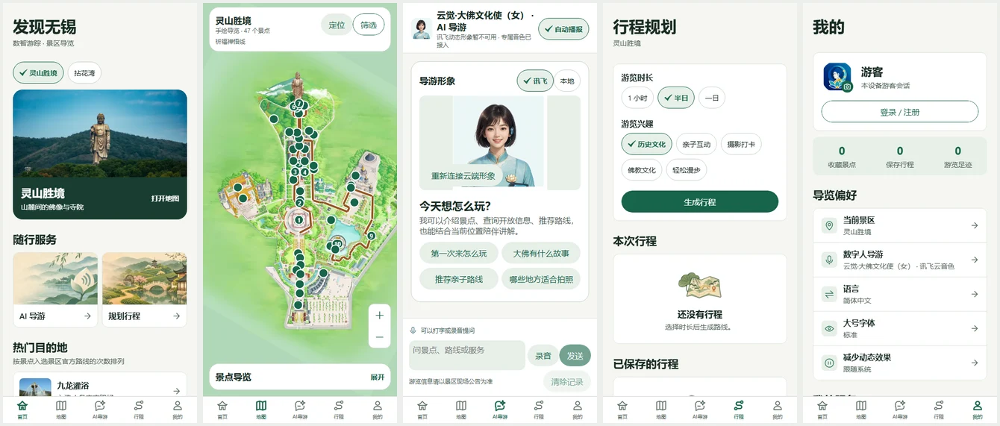

# 数智游踪 · 移动端设计系统

本规范服务于 visitor-app 游客端。以真实景区影像和现地名称帮助游客辨认位置，用自然绿标明下一步操作，AI 的说话、收音和等待均有可读的状态。五个根页沿用系统路由，导游页的中央语音保留四个相邻目的地的位置。景区标定、会话与平台原生能力沿用现有实现。[根页导航](components/navigation.md)

[浏览器验收](quality/web-verification.md) · [Android 模拟器](quality/android-verification.md) · [微信模拟器与包体](quality/wechat-verification.md) · [语音与地图](quality/guide-verification.md) · [行程与个人设置](quality/travel-page-verification.md)

新导游的[沉浸式页面双引擎验收](quality/ai-guide-immersive-web-verification.md)含实际 H5 舞台在轻声、正常音量和静音之间变化的短片，及两种屏宽下的收音、字幕、历史与打断结果。

[微信光球与电平条自测](quality/wechat-orb-self-test.md)记录收音期间三段强度的响应，以及说完后电平条能否回到静音。

底栏改造后的页面、切页与录音手势实测见[自适应底栏交付记录](quality/guide-navigation-verification.md)。其中记录了各宿主的实测范围及真机联调条件。

本轮增量实测见[五个子页](quality/subpage-verification.md)、[热门目的地与到访记录](quality/home-followup.md)、[导游与地图三语](quality/guide-locale-verification.md)、[动效和来源](quality/motion-source-verification.md)、[Android 端上复核](quality/android-followup.md)、[原生最终构建与回前台录音](quality/native-final-builds.md)及[微信正式 AppID 七页实测与截图](quality/wechat-followup.md)。[逐条规则索引](references/rule-provenance.md)可用于查找每项具体上游或工程契约。

## 从修改任务找到入口

| 修改对象 | 先读 | 工程入口 |
| --- | --- | --- |
| 颜色、字号、安全区、放大、暗色 | [基础与 Token](foundation/design-tokens.md) | visitor-app/design/tokens.json、uni.scss、theme.json |
| 按钮、导航、表单、卡片、反馈 | [组件契约](components/component-guidelines.md) 与[交互状态](interaction/interaction-states.md) | visitor-app/components、uni_modules/rice-ui、pages.json |
| 动效、连续点击、减少动态效果 | [动效参数](motion/motion-tokens.md)、[情境配方](motion/motion-principles.md) | visitor-app/design/motion.uts |
| 沉浸式 AI 导游与说话主操作 | [页面](pages/ai-guide.md)、[组件](components/ai-guide-components.md)、[交互](interaction/ai-guide-interaction.md)、[动效](motion/ai-guide-motion.md)、[工程边界](engineering/ai-guide-architecture.md) | visitor-app/pages/ai-guide、原生/网页数字人舞台 |
| AI Ambient Orb 与真实音量 | [可行性](engineering/ai-ambient-orb-feasibility.md)、[组件](components/ai-ambient-orb.md)、[动效](motion/ai-ambient-orb-motion.md)、[交互](interaction/ai-ambient-orb-interaction.md)、[架构](engineering/ai-ambient-orb-architecture.md)、[专项验收](quality/ai-ambient-orb-checklist.md) | 可见页面状态 + 当前录音/播放 owner 的可选电平 |
| 图标、摄影、占位、授权 | [图标](assets/icon-guidelines.md)、[摄影](assets/image-guidelines.md)、[来源和分发](assets/asset-management.md) | visitor-app/design/icons、static |
| 具体页面 | [首页](pages/home.md) · [地图](pages/map.md) · [AI 导游](pages/ai-guide.md) · [行程](pages/trip.md) · [我的](pages/profile.md) | visitor-app/pages |
| 跨端、交付、验证 | [UTS 与 Vapor](engineering/component-architecture.md) · [平台差异](engineering/cross-platform-compatibility.md) · [质量门禁与实测](quality/release-checklist.md) | HBuilderX CLI 及对应宿主 |

## 维护链

本轮导游页的代码入口、微信减动复现、声音实录、跨端构建与真机准备清单见[沉浸式 AI 导游交付记录](quality/ai-guide-immersive-verification.md)。

1. 先按[改造前审计](audit/current-mobile-ui-audit.md)定位业务和技术边界，再打开对应模块源文件和页面规范。
2. [来源索引](references/source-index.md)维护规则 ID、出发点、适配与复测方法。[来源完整性审计](audit/skill-integrity-audit.md)提供五个候选库的版本、许可、文件清单和引用关系。本文档为项目原创适配，第三方许可随归档保留。
3. 变更规则时在来源索引追加版本差异。同步规范、Token 或组件、对应的项目 Skill 及验收用例。根目录 [AGENTS.md](../../AGENTS.md)规定工程入口。
4. [项目 Skills](../../.agents/skills/)通过相对路径读取本知识库。上游动效仓库的完整离线快照在 motion-design/references/upstream；无需安装 React、Framer Motion、GSAP 或调用在线服务。
5. [交付记录](quality/release-checklist.md)区分编译、模拟操作、真实设备与供应商联调。仅经设备或宿主观察的事项可填入相应验收栏。
